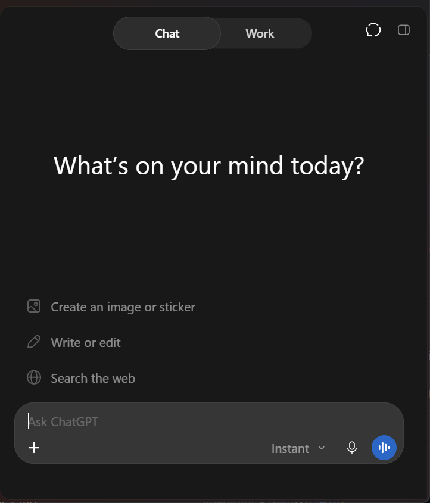
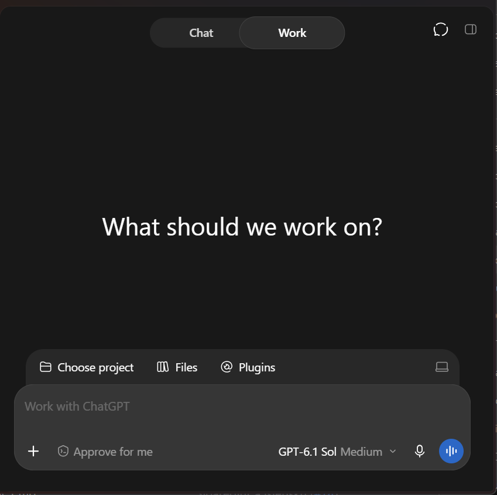
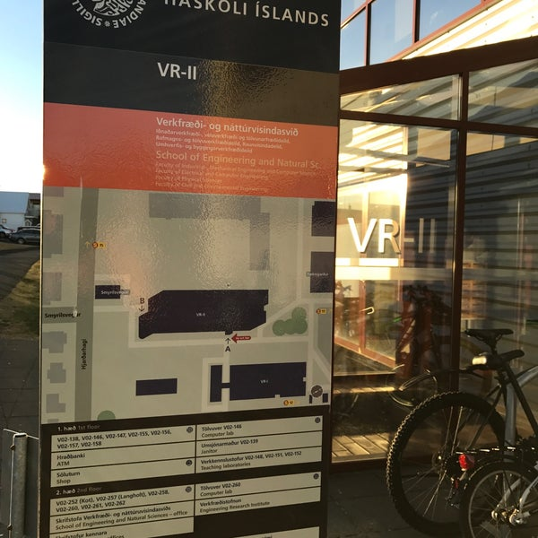



## Tilkoma spunagreindar og mat á hæfni

:::: {.assess-table}
::: {.oppose left="Það sem við sjáum" right="Hvernig getum við brugðist við" left-icon="eye" right-icon="lightbulb"}
- Nánast fullkomin verkefnaskil, en illa gengur í prófum | Nemendur skjala notkun gervigreindar
- Kennarar færast aftur í skrifleg próf | Ítarlegt rýnisferli
- Erfitt að rengja notkun, svo gerum ráð fyrir henni | Meiri munnleg yfirferð
:::
::::

::: {.win-win}
Erum við að meta hæfni nemenda, eða [aðgang að áskrift]{.hl}?
:::

::: {.win-win .light}
Eða erum við að fara aftur úr símati í 100% próf, því við viljum ekki veita Claude eða Codex háskólagráðu?
:::

::: {.notes}
- Hugleiðing í lokin til að opna umræðu, ekki niðurstaða úr rannsókn.
- Við sjáum nemendur skila nánast fullkomnum verkefnum en ganga illa á prófum. Þess vegna eru kennarar að færast aftur úr heimaverkefnum í skrifleg próf, því nemendur nota spunagreind.
- Kennarar mega "banna" gervigreind í sínum áföngum, en það er erfitt að rengja notkun hennar. Raunhæfara er að ganga út frá því að nemendur noti hana. Spurningin er hvernig við metum hæfni nemenda núna.
- Mín hugmynd: láta nemendur skjala notkun gervigreindar, fara í gegnum ítarlegt rýnisferli og fela meira í munnlega yfirferð.
- Munnleg yfirferð er tímafrek fyrir marga nemendur og erfitt að útfæra reglulega. Þetta er opin spurning, ekki lausn.
- Erum við að meta hæfni nemenda, eða aðgang að áskrift?
- Eða erum við að fara aftur úr símati í 100% próf, því við viljum ekki veita Claude eða Codex háskólagráðu?
:::

## Hvað er AI-erindreki?

:::: {.agent-triple}
::: {.agent-shot}

:::

::: {.oppose left="Chat" right="Work" left-icon="comments" right-icon="robot"}
- Svarar spurningum | Tekur verkefni að sér
- Samhengi er samtalið | Samhengi er verkefnið
- Engin verkfæri | Skrár, skipanir, prófanir
- Notandinn ber ábyrgð | Notandinn sannreynir
:::

::: {.agent-shot}

:::
::::

::: {.agent-cards}
::: {.fa-card cols=3}
- code | **Breyta** | Skrifa kóða og vinna í mörgum skrám
- terminal | **Prófa** | Keyra skipanir og prófanir
- list-check | **Skila** | Undirbúa lausn og leggja til næstu skref
:::
:::

::: {.callout .agent-callout}
Chat svarar. Work getur tekið verkefni að sér.

Erindreki vinnur í samhengi verkefnisins og notar verkfæri. Manneskjan stýrir, sannreynir og ber ábyrgð.
:::

::: {.notes}
- Chat er spjallið; Work er vinnusvæðið sem tekur við verkefni og getur nýtt samhengi og verkfæri.
- Sams konar framkvæmdamiðuð nálgun er í Codex og Claude Code.
- Erindrekinn getur breytt mörgum skrám og keyrt verkfæri. Hann skilar vinnu sem manneskja þarf að yfirfara.
- Næsta glæra sýnir hvernig ég tengi þetta við Git-vinnuferli nemenda.
:::

## Kóðarýni með PR: feimni við að gagnrýna jafningja

::: {.oppose left="Vandinn" right="Hugmyndin" left-icon="user-group" right-icon="robot"}
- Nemendur sjá að lausn er gölluð, en vilja ekki setja út á vinnu jafningja | Þau rýna verk erindreka teymisfélaga, ekki teymisfélagann
- Skrifleg athugasemd er upplifuð sem áfellisdómur | Athugasemd við verk erindreka er ekki persónuleg
- Rýnin verður yfirborðsleg í stað efnislegrar | Efnisleg rýni og stýring erindreka æfast saman
:::

::: {.context-box .blue}
Kóðarýni er algeng í atvinnulífinu en lítið kennd, og hluti af faglegri hæfni.
:::

::: {.context-box}
Notkun AI-erindreka vex hratt og verður nýr staðall.
:::

::: {.win-win}
**Tvær flugur í einu höggi**

Nemendur æfa uppbyggilega rýni án feimni og læra um leið að vinna með erindrekum.
:::

::: {.notes}
- Tími: 3:00
- Ég hef kennt nemendum Git-vinnuflæði og kóðarýni með PR. Það hefur gengið upp og ofan.
- Kóðarýni er mjög eðlilegur og tíðkaður þáttur í hugbúnaðargerð í atvinnulífinu, en er lítið kynnt fyrir nemendum. Hún er hluti af faglegri hæfni sem ég er að kenna.
- Notkun AI-erindreka í fyrirtækjum vex hratt og er að verða nýr staðall. Við þurfum að undirbúa nemendur fyrir vinnu með þeim.
- Vandinn er ekki að þau sjái ekki að eitthvað sé að lausn. Þau vilja ekki setja út á vinnu jafningja, eins og skrifleg athugasemd sé áfellisdómur.
- Ég reyni að tala þau af þessu: þetta er iðnaðarstaðall, og ef við erum uppbyggileg er rýnin holl og gagnleg fyrir alla, bæði þá sem rýna og þá sem eru rýndir.
- Hugmyndin: í stað þess að rýna efni sem samnemandi skrifaði rýna þau efni sem "þjarkur" á vegum samnemanda skrifaði. Þá eru þau kannski ekki jafn feimin, og um leið kennum við hvernig á að nota erindreka.
- Næsta glæra sýnir hvernig þetta lítur út í þriggja manna teymi.
- Win-win: iðnaðurinn er að þróast í notkun erindreka og við getum vonandi kennt nemendum réttu tökin (eða í áttina að þeim) sem hluta af þjálfun.
- Þetta er hugmynd sem ég er að prófa, ekki niðurstaða úr rannsókn.
:::

## Námsmarkmiðið er faglegt vinnuferli

Í IÐN302G læra nemendur faglegt vinnuferli með eigin gögn í teymum:

::: {.steps}
- Afmarka verkefni
- Fela erindreka afmarkað verk
- Prófa og rýna breytingar
- Útskýra niðurstöðuna
- Taka ábyrgð á lokaafurðinni
:::

Svona tengist notkun erindreka Git-vinnuferli nemenda:

```{mermaid}
%%| label: agent-review-flow
%%| fig-align: center
%%| out-width: 100%
%%{init: {"theme": "base", "themeVariables": {"fontFamily": "Jost, sans-serif", "fontSize": "15px", "lineColor": "#10099F"}, "flowchart": {"curve": "linear", "nodeSpacing": 12, "rankSpacing": 18, "padding": 8}}}%%
flowchart LR
    A["Eigin grein / draft PR<br/>Issue og skýr fyrirmæli"] --> B["Erindreki leggur til<br/>afmarkaða lausn"]
    B --> C["Eigin yfirferð<br/>Lesa · prófa · skrá"]
    C -- "lagfæringar" --> B
    C -- "tilbúið" --> D["Ready for review<br/>tveir teymisfélagar rýna"]
    D -- "athugasemdir" --> B
    D -- "samþykki" --> E["Sameining<br/>skv. reglum geymslunnar"]
    classDef start fill:#10099F,stroke:#10099F,color:#FFFFFF,stroke-width:2px
    classDef agent fill:#2DD2C0,stroke:#10099F,color:#10099F,stroke-width:2px
    classDef self fill:#FAC55B,stroke:#10099F,color:#262626,stroke-width:2px
    classDef team fill:#FFA05F,stroke:#10099F,color:#262626,stroke-width:2px
    classDef done fill:#FC8484,stroke:#10099F,color:#262626,stroke-width:2px
    class A start
    class B agent
    class C self
    class D team
    class E done
```

Lagfæringar fara aftur í eigin yfirferð áður en rýni teymisins heldur áfram.

Samhengi:

::: {.fa-card cols=3}
- code-pull-request | **PR (pull request)** | Tillaga að breytingu á kóða sem aðrir rýna og samþykkja áður en hún er sameinuð í verkefnið.
- users | **Teymisnám (TBL)** | Nemendur vinna saman og skipta með sér verkum.
- scale-balanced | **Deila og drottna** | GitHub PR tryggir að allir nái hæfniviðmiðum, þótt verkum sé skipt.
:::

## Verklag fyrir nemendur

:::: {.agent-files-layout}
::: {.agent-files-cards}
::: {.fa-card cols=1}
- file-lines | `AGENTS.md` | Varanleg fyrirmæli um hvernig erindrekinn á að vinna í verkefninu.
- pen | `AGENT_LOG.md` | Ígrundun nemandans um hvernig hann notaði erindrekann: fyrirmæli, tól, prófanir, eigin yfirferð og óvissa.
- screwdriver-wrench | **Skills · síðar** | Endurnýtanlegt verklag fyrir stærri eða endurtekin verkefni.
:::
:::

::: {.agent-files-table}

```{=html}
<table class="pr-table">
<colgroup><col style="width:42%"><col style="width:29%"><col style="width:29%"></colgroup>
<thead><tr><th>Nemandi</th><th>Erindreki</th><th>Teymisfélagar</th></tr></thead>
<tbody>
<tr class="pr-phase pr-phase-1"><td colspan="3">1. Eigin grein / draft PR · nemandinn fer yfir fyrst</td></tr>
<tr><td><strong>Afmarkar verkefnið.</strong> Skráir skýr fyrirmæli, t.d. í issue. Vinnur á eigin grein; getur opnað draft PR.</td><td>Leggur til lausn út frá fyrirmælum nemandans.</td><td class="pr-muted" rowspan="2">Engin formleg rýni enn.</td></tr>
<tr><td><strong>Les og prófar.</strong> Biður um lagfæringar þar til hann skilur lausnina og hún virkar. Skráir AI-notkun.</td><td>Útskýrir og lagfærir eftir athugasemdum nemandans.</td></tr>
<tr class="pr-phase pr-phase-2"><td colspan="3">2. Ready for review · nú rýnir teymið</td></tr>
<tr><td><strong>Óskar eftir rýni.</strong> Opnar PR til rýni eða merkir draft PR Ready for review.</td><td></td><td><strong>Rýna breytingarnar.</strong> Senda athugasemdir.</td></tr>
<tr><td><strong>Lagar og prófar aftur.</strong> Svarar athugasemdum rýnenda.</td><td>Aðstoðar við lagfæringar eftir þörfum.</td><td><strong>Yfirfara lagfæringar og samþykkja.</strong></td></tr>
<tr><td><strong>Sameinar eftir samþykki</strong> samkvæmt reglum geymslunnar.</td><td></td><td></td></tr>
</tbody>
</table>
```

:::
::::

<p class="slide-subtitle">Opið kennsluefni námskeiðsins: <a href="https://hi-idn.github.io/IDN302G/ai-tools/">hi-idn.github.io/IDN302G/ai-tools</a></p>

::: {.notes}
- Tími: 1:30
- Nemendur rugla stundum þessum skrám saman af því heitin eru lík.
- AGENTS.md geymir leiðbeiningar sem eiga að gilda í verkefninu. Hún er ekki skrá yfir hvað gerðist í einu PR.
- AGENT_LOG.md er stutt skrá yfir notkunina í þessu PR: fyrirmæli, hvaða verkfæri var notað, hvað breyttist, hvað var prófað og hvað þarf enn að athuga.
- Taflan sýnir verklagið sem nemendur fá: hver gerir hvað, þú, erindrekinn og teymisfélagarnir. Þetta er í raun hvernig ég kenni notkun erindreka.
- Skills eru næsta lag: endurnýtanleg verklag fyrir ákveðin verk. Ég kynni þau þegar nemendur eru orðnir öruggari með grunnferlið.
:::

## Erindrekinn og nemandinn

:::: {.agent-split}
::: {.oppose left="Erindrekinn getur" right="Nemandinn þarf að geta" left-icon="robot" right-icon="user"}
- Skrifað og breytt kóða | Útskýrt hvað kóðinn gerir
- Breytt mörgum skrám hratt | Afmarkað nauðsynlegar breytingar
- Keyrt skipanir og prófanir | Metið hvort prófanir dugi
- Samið skýrslu | Metið fullyrðingar, rök og niðurstöður
- Unnið hratt og sjálfstætt | Stöðvað, einfaldað og breytt um stefnu
- Búið til sannfærandi lausn | Sannreynt lausnina og tekið ábyrgð
:::

::: {.agent-split-cards}
::: {.fa-card cols=1}
- user-graduate | **Junior developer** | Nemendur eru eins og nýliðar sem erfa kóða sem aðrir skrifuðu.
- robot | **Í atvinnulífinu** | Erindrekar skrifa sífellt meira af kóðanum; fagfólk les, prófar og ber ábyrgð.
- scale-balanced | **Hæfni sem fæst með reynslu** | Nemendur samþykkja PR áður en þeir vita hvað er gott vinnulag.
:::
:::
::::

::: {.win-win .light}
*Hvernig kennum við nemendum að koma inn í kóða sem aðrir skrifuðu, óháð erindrekum?*

*Hvernig kennum við hæfni junior og senior developer á sama tíma, áður en nemandinn hefur reynsluna?*
:::

::: {.notes}
- Nemendur eru í raun junior developers: þeir koma inn í kóða sem einhver annar, nú oft erindreki, skrifaði.
- Í atvinnulífinu skrifa erindrekar sífellt meira af kóðanum, en fagfólkið les, prófar og ber ábyrgð. Þessa hæfni þurfum við að þjálfa.
- Þetta er hæfni sem fæst venjulega með reynslu í starfi. Nemendur samþykkja PR áður en þeir vita hvað er gott eða slæmt vinnulag, og spurningin er hvernig við kennum hana í námi.
- Spyrðu salinn: hvernig kennum við þessa hæfni, og hvernig getum við nýtt raunveruleg PR-dæmi og viðmið úr atvinnulífinu í kennslu?
:::

## Kennsluhönnunin gerir mannlega stjórn sýnilega

::: {.steps}
- Markmið og afmörkun
- Erindrekinn framkvæmir
- Nemandinn prófar og rýnir
- Nemandinn ákveður og ber ábyrgð
:::

::: {.fa-card cols=4}
- file-lines | `AGENTS` | Skilgreina verkefnareglur og samhengi
- [hi-teal] clipboard-list | `AGENT_LOG` | Skrá notkun erindrekans og mannlega yfirferð
- [hi-yellow] code-pull-request | **Pull request** | Teymið les, prófar og gagnrýnir afmarkaða breytingu
- [hi-orange] user-check | **iTA** | Verkefnastjóri útskýrir ákvarðanir og vinnulag teymisins
:::

::: {.lead}
Mannleg yfirferð er hluti af verkinu sjálfu, ekki lokaathugasemd eftir að erindrekinn er búinn.
:::

::: {.win-win .light}
iTA er einskonar munnlegt próf sem ég bæti við TBL-ferlið: fyrst koma iRAT/tRAT og tAPP, svo iTA (individual team assessment), þar sem ég spyr verkefnastjóra lotunnar hvernig ákvarðanir voru teknar og hvernig verkefnið var leyst.
:::

## Niðurstöður eftir fyrstu sjö vikurnar

::: {.section-label}
Svör úr miðmisseriskönnuninni
:::

::: {.fa-card cols=2}
- lightbulb | **Áhugi** | Nemendur nefna raunhæf verkefni og áhuga á að kynnast erindrekum
- triangle-exclamation | **Álag** | Umfang, Git-vinnuferli og óskýrar væntingar valda áhyggjum
:::

::: {.section-label}
Athuganir kennara á vinnuferli teymanna
:::

::: {.oppose left="Óbeislaður erindreki" right="Taminn erindreki" left-icon="robot" right-icon="user-check"}
- Framleiðir meira og flóknara en teymið nær að yfirfara | Fær afmarkað verkefni sem teymið getur yfirfarið
- Erfiðara að halda yfirsýn og skilningi | Teymið heldur betur yfirsýn og skilningi
:::

::: {.yellow-takeaway}
**Magn og hraði eru ekki mælikvarðar á gæði.**<br>Afmörkun felst líka í að ákveða hvað erindrekinn á ekki að framleiða og hvernig vinnunni er skipt.
:::

## {.focus-slide}

::: {.two-col}
::: {.col}
{.contact-photo style="max-height: 520px;"}
:::

::: {.col}
```{=html}
<div class="closing-q">Hvernig tryggjum við að hæfni nemenda sé náð á tímum spunagreindar, en styðjum um leið virkt nám?</div>
<div class="closing-q">Hvernig kennum við nemendum að nota erindreka á ábyrgan og faglegan hátt?</div>
```

<p class="closing-link">Námsefni um notkun erindreka: <a href="https://hi-idn.github.io/IDN302G/ai-tools/">hi-idn.github.io/IDN302G/ai-tools</a></p>


:::
:::
