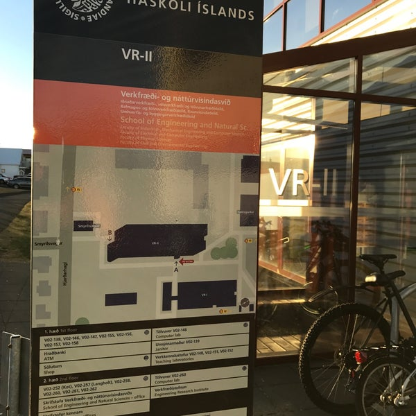



::: {.notes}
- Tími: 0:45
- Erindrekinn fær markmið, samhengi og verkfæri; hlutverk manneskjunnar færist nær afmörkun og yfirferð.
- Ég sýni vinnulag sem tengir notkun erindreka við venjulegt Git- og rýni­ferli.
:::

## AI-erindrekar í háskólanámi

:::: {.fa-card cols=2 .opening-cards}
- users | **Nemendur** | Taka upp ný tól hratt þegar þau sjá að þau létta þeim lífið.
- chalkboard-user | **Kennsla** | HÍ hvetur til ábyrgrar gervigreindarnotkunar. Notkun erindreka er á frumstigi hjá kennurum, hvað þá í kennslu.
- briefcase | **Atvinnulíf** | Krafan um að vinna með erindrekum vex hratt. Nemendur þurfa að vera undirbúnir.
- laptop-code | **Grunnnám í verkfræði** | Ég kenni hugbúnaðargerð á hundavaði: GitHub, vefþjónustur, regex, SQL, myndræn framsetning, gagnasögur.
:::

::: {.tldr-box}
<p class="tldr-summary">Getum við kennt notkun erindreka samhliða faginu — og tryggt að <span>hæfnin sé nemandans</span> en ekki áskriftarleið hans?</p>
<p class="teacher-learning">Á meðan ég er sjálf að tileinka mér þessa færni jafnóðum.</p>
:::

::: {.notes}
- Tími: 1:15
- **Nemendur:** Þeir eru vanir að taka upp ný tæki og tól þegar þeir sjá hag í því. Ef tól léttir þeim lífið er lítil fyrirstaða.
- **Kennarar:** Meiri tregða í kennslunni, svolítið eins og að kenna gömlum hundi ný trikk. Gervigreind er ekki komin eins langt hjá kennurum og hjá nemendum.
- **Stefna HÍ:** Hvetur til ábyrgrar notkunar. Áherslan er á akademískt frelsi (hver kennari ákveður útfærslu), vísindaleg heilindi, siðfræði og höfundarrétt. Lítið sem ekkert um praktíska notkun, og almennt rætt um spunagreind frekar en erindreka.
- **Stikkprufa í minni deild (IVT):** Flestir nota spunagreind í mismiklum mæli; erindrekar eru skemur á veg komnir. Frumstig: fáir byrjaðir, helst ákveðnir aðilar sem vinna að þessu og birta um það, og enn færri í kennslu.
- **Tækifærið:** Ég kenni hugbúnaðargerð á hundavaði fyrir verkfræðinema: vefþjónustur, gagnagrunna, regex, myndræna framsetningu, gagnasögur, með GitHub-vinnuferlum og áherslu á hvað nýtist atvinnulífinu.
- Atvinnulífið færir sig augljóslega í átt að erindrekum. Við þurfum að undirbúa nemendur og yfirfæra verkfræðilega hugsun, ferlagreiningu og ábyrgð á vinnunni yfir í samtalsmiðuð vinnubrögð.
- **Spurningin:** Hvernig tryggjum við að hæfnin sé nemandans en ekki áskriftarleiðarinnar? Við gefum ekki Claude eða Codex verkfræðigráðu, við gefum nemandanum gráðu.
- Vil helst ekki fara aftur í lokapróf: þriggja tíma próf smækkar vinnuna og gleymist. Frekar vinna allt misserið að því að virkja nemendur, læra, rýna og bæta.
:::

---

## Kóðarýni með PR: feimni við að gagnrýna jafningja

::: {.oppose left="Vandinn" right="Hugmyndin" left-icon="user-group" right-icon="robot"}
- Nemendur sjá að lausn er gölluð, en vilja ekki setja út á vinnu jafningja | Þau rýna verk erindreka teymisfélaga, ekki teymisfélagann
- Skrifleg athugasemd er upplifuð sem áfellisdómur | Athugasemd við verk erindreka er ekki persónuleg
- Rýnin verður yfirborðsleg í stað efnislegrar | Efnisleg rýni og stýring erindreka æfast saman
:::

::: {.win-win}
**Tvær flugur í einu höggi**

Nemendur æfa uppbyggilega rýni án feimni og læra um leið að vinna með erindrekum.
:::

::: {.notes}
- Tími: 3:00
- Ég hef kennt nemendum Git-vinnuflæði og kóðarýni með PR. Það hefur gengið upp og ofan.
- Vandinn er ekki að þau sjái ekki að eitthvað sé að lausn. Þau vilja ekki setja út á vinnu jafningja, eins og skrifleg athugasemd sé áfellisdómur.
- Ég reyni að tala þau af þessu: þetta er iðnaðarstaðall, og ef við erum uppbyggileg er rýnin holl og gagnleg fyrir alla, bæði þá sem rýna og þá sem eru rýndir.
- Hugmyndin: í stað þess að rýna efni sem samnemandi skrifaði rýna þau efni sem "þjarkur" á vegum samnemanda skrifaði. Þá eru þau kannski ekki jafn feimin, og um leið kennum við hvernig á að nota erindreka.
- Næsta glæra sýnir hvernig þetta lítur út í þriggja manna teymi.
- Win-win: iðnaðurinn er að þróast í notkun erindreka og við getum vonandi kennt nemendum réttu tökin (eða í áttina að þeim) sem hluta af þjálfun.
- Þetta er hugmynd sem ég er að prófa, ekki niðurstaða úr rannsókn.
:::

---

## Þrír nemendur, þrír erindrekar, ein PR-keðja

Í IÐN302G læra nemendur faglegt vinnuferli með eigin gögn í teymum:

::: {.steps}
- Afmarka verkefni
- Fela erindreka afmarkað verk
- Prófa og rýna breytingar
- Útskýra niðurstöðuna
- Taka ábyrgð á lokaafurðinni
:::

Svona tengist notkun erindreka Git-vinnuferli nemenda:

```{mermaid}
%%| label: agent-review-flow
%%| fig-cap: "Lagfæringar fara aftur í eigin yfirferð áður en rýni teymisins heldur áfram."
%%| fig-align: center
%%| out-width: 100%
%%{init: {"theme": "base", "themeVariables": {"fontFamily": "Jost, sans-serif", "fontSize": "17px", "lineColor": "#10099F"}, "flowchart": {"curve": "linear", "nodeSpacing": 16, "rankSpacing": 22, "padding": 10}}}%%
flowchart LR
    A["Eigin grein / draft PR<br/>Issue og skýr fyrirmæli"] --> B["Erindreki leggur til<br/>afmarkaða lausn"]
    B --> C["Eigin yfirferð<br/>Lesa · prófa · skrá"]
    C -- "lagfæringar" --> B
    C -- "tilbúið" --> D["Ready for review<br/>tveir teymisfélagar rýna"]
    D -- "athugasemdir" --> B
    D -- "samþykki" --> E["Sameining<br/>skv. reglum geymslunnar"]
    classDef start fill:#10099F,stroke:#10099F,color:#FFFFFF,stroke-width:2px
    classDef agent fill:#2DD2C0,stroke:#10099F,color:#10099F,stroke-width:2px
    classDef self fill:#FAC55B,stroke:#10099F,color:#262626,stroke-width:2px
    classDef team fill:#FFA05F,stroke:#10099F,color:#262626,stroke-width:2px
    classDef done fill:#FC8484,stroke:#10099F,color:#262626,stroke-width:2px
    class A start
    class B agent
    class C self
    class D team
    class E done
```

::: {.notes}
- Tími: 3:00
- Þetta er þriggja manna teymi: þrír nemendur, hver með eigin erindreka. Erindrekinn kemur ekki í stað teymisfélaganna.
- Fyrst notuðu nemendur spunagreind aðallega í spjalli og copy-paste. Nú vinna þeir markvisst inni í eigin verkefni með erindreka.
- Höfundur afmarkar verkefnið í issue, vinnur á eigin grein og getur opnað draft PR. Fyrst les hann breytingarnar sjálfur, prófar þær og skráir AI-notkun.
- Þegar lausnin er skilin og sannreynd fer PR í formlega rýni tveggja teymisfélaga.
- Athugasemdir og lagfæringar fara aftur í eigin yfirferð. Hver nemandi er höfundur að einu PR og rýnir tvö önnur; þannig æfa þau Git, kóðarýni og sameiginlega ábyrgð um leið og þau læra að stýra erindreka.
:::

---

## Verklag fyrir nemendur

:::: {.agent-files-layout}
::: {.agent-files-cards}
::: {.fa-card cols=1}
- file-lines | `AGENTS.md` | Varanleg fyrirmæli um hvernig erindrekinn á að vinna í verkefninu.
- pen | `AGENT_LOG.md` | Ígrundun nemandans um hvernig hann notaði erindrekann: fyrirmæli, tól, prófanir, eigin yfirferð og óvissa.
- screwdriver-wrench | **Skills · síðar** | Endurnýtanlegt verklag fyrir stærri eða endurtekin verkefni.
:::
:::

::: {.agent-files-table}

```{=html}
<table class="pr-table">
<colgroup><col style="width:42%"><col style="width:29%"><col style="width:29%"></colgroup>
<thead><tr><th>Nemandi</th><th>Erindreki</th><th>Teymisfélagar</th></tr></thead>
<tbody>
<tr class="pr-phase pr-phase-1"><td colspan="3">1. Eigin grein / draft PR · nemandinn fer yfir fyrst</td></tr>
<tr><td><strong>Afmarkar verkefnið.</strong> Skráir skýr fyrirmæli, t.d. í issue. Vinnur á eigin grein; getur opnað draft PR.</td><td>Leggur til lausn út frá fyrirmælum nemandans.</td><td class="pr-muted" rowspan="2">Engin formleg rýni enn.</td></tr>
<tr><td><strong>Les og prófar.</strong> Biður um lagfæringar þar til hann skilur lausnina og hún virkar. Skráir AI-notkun.</td><td>Útskýrir og lagfærir eftir athugasemdum nemandans.</td></tr>
<tr class="pr-phase pr-phase-2"><td colspan="3">2. Ready for review · nú rýnir teymið</td></tr>
<tr><td><strong>Óskar eftir rýni.</strong> Opnar PR til rýni eða merkir draft PR Ready for review.</td><td></td><td><strong>Rýna breytingarnar.</strong> Senda athugasemdir.</td></tr>
<tr><td><strong>Lagar og prófar aftur.</strong> Svarar athugasemdum rýnenda.</td><td>Aðstoðar við lagfæringar eftir þörfum.</td><td><strong>Yfirfara lagfæringar og samþykkja.</strong></td></tr>
<tr><td><strong>Sameinar eftir samþykki</strong> samkvæmt reglum geymslunnar.</td><td></td><td></td></tr>
</tbody>
</table>
```

:::
::::

<p class="slide-subtitle">Opið kennsluefni námskeiðsins: <a href="https://hi-idn.github.io/IDN302G/ai-tools/">hi-idn.github.io/IDN302G/ai-tools</a></p>

::: {.notes}
- Tími: 1:30
- Nemendur rugla stundum þessum skrám saman af því heitin eru lík.
- AGENTS.md geymir leiðbeiningar sem eiga að gilda í verkefninu. Hún er ekki skrá yfir hvað gerðist í einu PR.
- AGENT_LOG.md er stutt skrá yfir notkunina í þessu PR: fyrirmæli, hvaða verkfæri var notað, hvað breyttist, hvað var prófað og hvað þarf enn að athuga.
- Taflan sýnir verklagið sem nemendur fá: hver gerir hvað, þú, erindrekinn og teymisfélagarnir. Þetta er í raun hvernig ég kenni notkun erindreka.
- Skills eru næsta lag: endurnýtanleg verklag fyrir ákveðin verk. Ég kynni þau þegar nemendur eru orðnir öruggari með grunnferlið.
:::

---

## Hvernig þetta tengist atvinnulífinu

:::: {.agent-split}
::: {.oppose left="Erindrekinn getur" right="Nemandinn þarf að geta" left-icon="robot" right-icon="user-check"}
- Breytt mörgum skrám hratt | Afmarkað hvað á að breytast
- Keyrt skipanir og prófanir | Metið hvort próf dugi
- Skrifað sannfærandi lausn | Útskýrt forsendur og áhættu
- Skilað breytingu í PR | Rýnt, brugðist við og tekið ábyrgð
:::

::: {.agent-split-cards}
::: {.fa-card cols=1}
- user-graduate | **Junior developer** | Hvernig tökum við á móti nýjum starfsmanni í kóðagrunn sem annar skrifaði?
- robot | **Hjá okkur** | Erindreki skrifar kóðann frá A til Ö, en við þjálfum sambærilega hæfni.
- scale-balanced | **Báðum megin borðsins** | Nemendur samþykkja PR sjálf, án reynslu af því hvað er gott vinnulag.
:::
:::
::::

::: {.win-win .plain}
*Hvernig kennum við onboarding almennt, óháð erindrekum?*

*Hvernig kennum við hæfni junior og senior developer á sama tíma, áður en nemandinn hefur reynsluna?*
:::

::: {.notes}
- Tími: 2:45
- Spurning fyrir atvinnulífið: hvernig tökum við á móti junior developer sem kemur inn í kóðagrunn sem einhver annar skrifaði? Hvað þarf hann að sýna áður en PR er samþykkt?
- Hjá okkur er kóðinn skrifaður af erindreka frá A til Ö, en við þjálfum sambærilega hæfni: að koma inn í kóða sem annar bjó til, skilja hann, prófa og gagnrýna.
- Munurinn er að nemendur taka öll ábyrgð á að samþykkja PR. Það er erfitt að vera báðum megin borðsins, að tryggja gæði án þess að hafa reynsluna til að vita hvað er gott eða slæmt vinnulag.
- Spyrðu salinn: hvað þurfa junior developers að sýna áður en þið samþykkið PR? Hvaða raunveruleg PR-dæmi eða viðmið mætti nota í kennslu?
:::

---

## Rýni og ábyrgð þurfa að halda í við hraðann

<p class="section-label">Munur sem ég sé á nemendateymum</p>

::: {.oppose left="Óbeislaður erindreki" right="Taminn erindreki" left-icon="robot" right-icon="user-check"}
- Framleiðir meira og flóknara en teymið nær að yfirfara | Fær afmarkað verkefni sem teymið getur yfirfarið
- Erfiðara að halda yfirsýn og skilningi | Teymið heldur betur yfirsýn og skilningi
:::

<p class="section-label">Það sem ég beini nemendum að</p>

::: {.fa-card cols=2}
- triangle-exclamation | **Áhættumerki** | Erindrekinn breytir víðar en beðið var um, próf vantar eða teymið skilur ekki forsendurnar.
- pause-circle | **Stöðvunarpunktur** | Minnka verkið, lesa allt diff og sannreyna forsendur áður en haldið er áfram.
:::

::: {.yellow-takeaway}
**Magn og hraði eru ekki mælikvarðar á gæði.**<br>Ef teymið getur ekki útskýrt breytinguna er hún ekki tilbúin til sameiningar.
:::

::: {.notes}
- Tími: 2:00
- Ég er ekki að kynna fullmótaða kennsluaðferð eða rannsóknarniðurstöðu. Þetta er heiðarleg tilraun á sviði sem er nýtt og enn lítið kortlagt í minni eigin kennslu.
- Ég er rétt skrefi á undan nemendum í notkun erindreka, en kem með áratuga reynslu af hugbúnaðargerð. Sú reynsla hjálpar mér að móta verkefnin, en hún þýðir ekki að ég hafi öll svör um kennslu erindreka.
- Erindrekinn getur skilað meiru og flóknari kóða en teymið nær að lesa og skilja.
- Þetta er eigin kennslureynsla úr fyrstu sjö vikum, ekki samanburðarrannsókn. Hagnýta viðmiðið er þó skýrt: minnka verkið þegar rýni nær ekki að fylgja.
:::

---

## {.focus-slide}

```{=html}
<h2 class="closing-h2">Þegar erindrekinn skrifar kóðann verða skilningur, sannprófun og ábyrgð enn mikilvægari.</h2>
```

::: {.two-col}
::: {.col}
{.contact-photo style="max-height: 400px;"}
:::

::: {.col}
```{=html}
<div class="closing-q">Hvernig getum við fært kennslu nær vinnulagi atvinnulífsins?</div>
<div class="closing-q">Hvað þurfa nemendur að kunna til að vera tilbúnir í ykkar vinnuumhverfi?</div>
```


:::
:::

::: {.notes}
- Tími: 1:15
- Þetta er lokaglæran; hún opnar umræður um tengsl kennslu og atvinnulífs.
- Spyrðu salinn hvernig fyrirtæki og háskóli geti mótað verkefni, viðmið og dæmi sem hjálpa nemendum að læra ábyrga notkun erindreka.
:::
